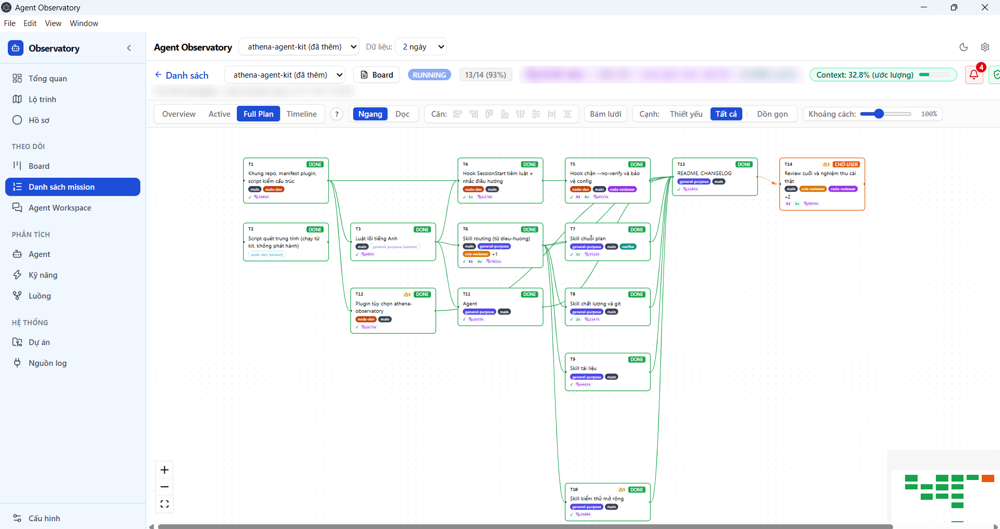

# Athena Starter

**Guardrails and a workflow for Claude Code: route every request, plan before coding, red test before fixing, independent review for risky changes, and a desktop dashboard to watch it all happen.**

[](LICENSE)
[](#quick-start)
[](https://github.com/zzgiabaozzbui/athena-starter/releases/latest)



*The plan above is the real 14-task plan that built this kit, shown in Agent Observatory: each card is a task with its status, agents and token use; edges are dependencies.*

## Why

| Without it | With Athena Starter |
|---|---|
| The agent starts editing before anyone agreed on scope. | Every new request gets a flow question first; scope goes into `intent.md` before any file changes. |
| Bugs get "fixed" without proof. | Bug fixes and behavior changes start with a test that fails for the right reason. |
| The agent reviews its own work and calls it done. | Risky changes go to a separate reviewer with fresh context; "done" needs the check output from this turn. |
| Plans and notes end up scattered across chats. | Each task has one folder, `docs/artifact/<date>-<name>/`, with intent, plan and a progress table a dashboard can read. |
| `git commit --no-verify` quietly skips your hooks. | Safety hooks block hook bypasses and edits that loosen lint config. |

## Quick start

```
/plugin install athena-starter --marketplace zzgiabaozzbui/athena-starter
```

Start a new session and ask for anything. The agent answers with a flow question, then works through the matching skill.

<details>
<summary>Older Claude Code, APM, and requirements</summary>

Claude Code before 2.1.275, two steps (the marketplace is named `athena`):

```
/plugin marketplace add zzgiabaozzbui/athena-starter
/plugin install athena-starter@athena
```

With APM:

```
apm install zzgiabaozzbui/athena-starter
```

The hooks run with `node`: Node 18 or later must be on your PATH. A native Claude Code install may not include Node; without it the hooks stay silent and do nothing.

</details>

## What a session looks like

1. **Route.** You ask for a change. The agent restates it and asks which flow fits (bug fix, feature, review, research...), recommended option first.
2. **Scope.** It writes `intent.md` with the files it may touch. Anything outside needs your OK by name.
3. **Plan.** Multi-step or risky work gets `plan.md` and `progress.md`, which you approve before any code changes.
4. **Build.** Tasks go to the right agent (`developer`, `quick-fix`...). Fixes start with a red test.
5. **Review and verify.** A reviewer with fresh context checks the diff; the main agent re-runs the checks itself instead of trusting the report.
6. **Commit.** Named files only, a sensitive-data scan before every commit, and no push without your OK.

## Agent Observatory desktop app

A local dashboard for the plans and agents in your repos: overview, Kanban board, mission list, full plan graph, timeline, roadmap, agent and skill usage.

**[Download the latest Windows installer](https://github.com/zzgiabaozzbui/athena-starter/releases/latest)** (`Agent-Observatory-Setup-*.exe`).

- Reads the `docs/artifact/` folders and progress tables that Athena Starter writes.
- Read-only and local: it listens on 127.0.0.1 only and sends nothing out.
- Windows only for now; the interface is in Vietnamese.

Prefer to stay inside Claude Code? The same app ships as an optional plugin:

```
/plugin install athena-observatory@athena
```

The plugin bundles the app as is. Besides Claude Code sessions it also reads transcripts of other coding agents and route logs when they exist; these are features of the app, not data shipped with it.

## What's inside

<details>
<summary>18 skills</summary>

| Skill | When to use |
|---|---|
| `routing` | First message of a session and every new request: picks the flow. |
| `brainstorming` | New request with no intent or spec yet. |
| `grilling` | Stress-test a plan or design before building. |
| `architecture` | Vague request, or adding / changing / connecting systems: C4 pictures before the plan. |
| `writing-plans` | Intent is settled: write plan.md and progress.md for approval. |
| `executing-plans` | Run an approved plan inline. |
| `subagent-driven-development` | Run an approved plan by delegating tasks to agents. |
| `test-driven-development` | Bug fix or behavior change: red test first. |
| `systematic-debugging` | Bug, red test or stack trace: find the root cause before fixing. |
| `commit-push` | Before every commit, push, tag or release. |
| `using-git-worktrees` | Wide refactor, parallel agents, or a dirty working tree. |
| `resolving-merge-conflicts` | A merge or rebase reports CONFLICT. |
| `docs-standards` | Writing or editing Markdown docs; sensitive-data check before commit. |
| `domain-modeling` | Business terms (GLOSSARY.md) and architecture decisions (ADRs). |
| `e2e-playwright` | Write, run or fix Playwright e2e tests for a web UI. |
| `security-testing` | Role x endpoint authorization tests and dependency audit. |
| `migrating-legacy-code` | Large upgrade, rewrite or modernization. |
| `prototype` | Throwaway code that answers one design question. |

</details>

<details>
<summary>6 agents</summary>

| Agent | Role |
|---|---|
| `developer` | Implements non-trivial changes from a spec or plan; returns diff and test output. |
| `researcher` | Read-only investigation and codebase analysis. |
| `quick-fix` | Small mechanical changes (typos, formatting, one-line fixes). |
| `code-reviewer` | Read-only review of code, rule, skill, agent and hook changes. |
| `verifier` | Independent build, typecheck, lint and test run; reports only. |
| `ux-tester` | Tries the real UI as a newcomer (needs the Playwright MCP server); reports only. |

</details>

<details>
<summary>3 hooks</summary>

- **SessionStart**: injects the core rules (`rules/core.md`) and reminds the agent to invoke `routing` first (after a context compaction it reminds the agent to resume the running plan instead).
- **Block `--no-verify`**: stops Bash commands that skip git hooks.
- **Protect lint config**: stops edits to existing lint / format config files (eslint, prettier, biome, commitlint); the agent must fix the code, not loosen the config.

</details>

## Safety and privacy

- No telemetry: the hooks only print to the session; they write no files and make no network calls.
- Before every commit the `commit-push` skill scans staged lines for credentials, long numbers, IPs, emails, machine paths and key files; it prints locations, never values.
- Pushes, tags and releases always wait for your OK.

## Customize

- Your project's `CLAUDE.md` and `.claude/rules/` win over these defaults. Declare your stack and verify commands there; the `developer` agent reads them.
- Each task keeps its documents in `docs/artifact/<YYYY-MM-DD-HHMM-name>/`. The progress table uses the columns `ID | Task | Deps | Status` with the statuses `TODO`, `DOING`, `CHỜ-USER` (waiting for the user), `BLOCKED`, `DONE`, `SKIP`. Details are in the `docs-standards` skill.
- To turn the hooks off, disable the plugin with `/plugin` (select `athena-starter`, then Disable).

## Releases

This repository also holds the official releases of Agent Observatory Desktop.

## License

MIT; see `LICENSE` for third-party sources.
