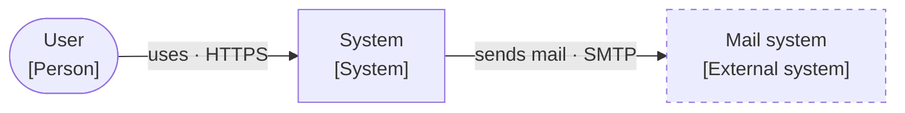
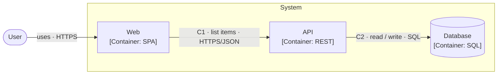
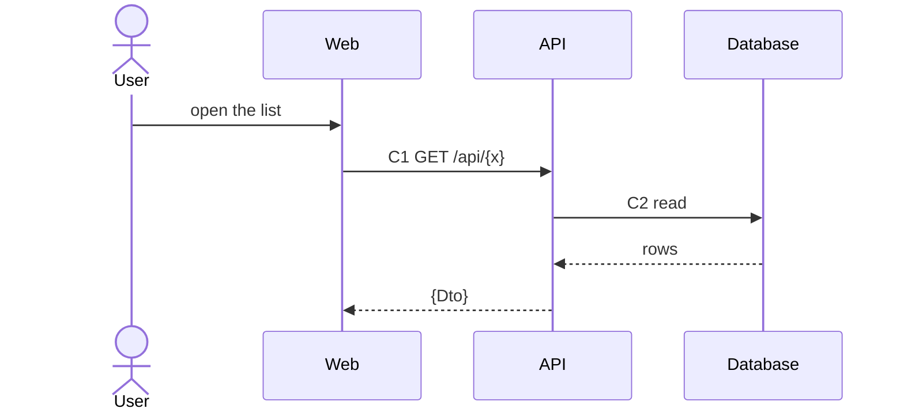

# C4 with Mermaid flowchart

## Conventions

- System boundary = `subgraph`. Person = `(["..."])`, container = `["..."]`, data store = `[("...")]`, external
  system adds `:::ext`.
- Node labels are always double-quoted: `"<Name><br/>[<Type>: <technology>]<br/><main job>"`. Without quotes the `[`
  and `:` break Mermaid.
- Arrow between two containers: `-->|"C<n> · <job> · <protocol>"|`. `C<n>` matches the Code column of the contract
  table. Arrows from a person need no code.
- At most 12 nodes per diagram; more -> split along a boundary.

## Template `docs/architecture/c4.md`

````md
# Architecture of <system>

Checked against code: <YYYY-MM-DD> · Related ADRs: <path in docs/adr/>

## Context



## Container



## Contract

| Code | From -> To | Job | Protocol | Contract |
|---|---|---|---|---|
| C1 | Web -> API | list items | HTTPS/JSON | `GET /api/<x>` -> `<Dto>` (task spec, section <...>) |
| C2 | API -> Database | read / write | SQL | `<table / procedure>` |
````

## Sequence

One diagram per main flow, placed in the task's `spec.md`:



## Self-check

1. Every arrow between two containers has a code; every code has one table row; the table has no extra rows.
2. Every message between containers in a sequence carries a code that is in the table.
3. Component exists only for the container being changed.
4. No personal data, credentials, or internal hosts / IPs (R-078); an internal external system is written by role.
