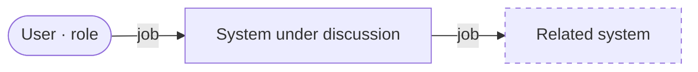

# Discovery - sections in research.md

Sections added to the task's `research.md`. `research.md` is input to a decision, not the final decision (R-092).

````md
## Overview



## Main business flow

1. <step> - <role doing it> - <which system>

## Rough scope

- In: <...>
- Out: <...>

## Assumptions

- **[Assumption]** <...>

## Open questions

| # | Question | Blocking? | Ask whom (role) |
|---|---|---|---|

## Options

### A · <name> (recommended)

<how, 2-3 sentences> · Gain: <...> · Loss: <...>

### B · <name>

<how, 2-3 sentences> · Gain: <...> · Loss: <...>
````

- The overview diagram has at most 10 nodes; more -> group them.
- A **blocking** question = a different answer means a different option. A blocking question still open -> Discovery
  is not finished.
- No personal data, credentials, or internal hosts / IPs in diagrams (R-078).
